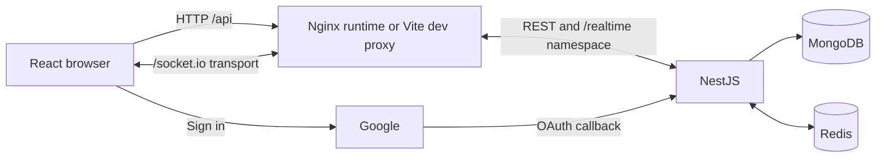
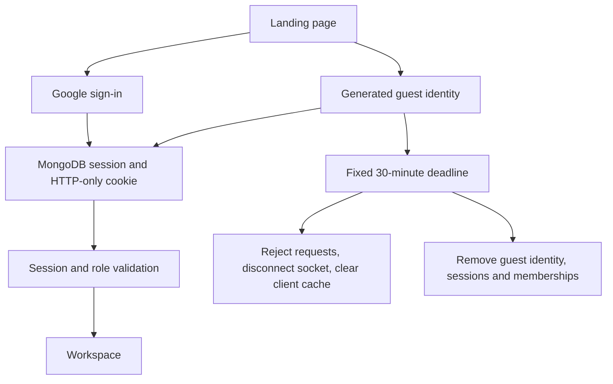

# ChatCord architecture

Reviewed: 2 November 2026. This is the current system map; module READMEs own implementation details, [verification guides](README.md#verification) own commands, and the [root README](../README.md) owns delivery status.

## System and runtime



The server owns authorization and persistence. The browser owns presentation and interaction state. HTTP and socket message creation use the same domain service. MongoDB stores durable data; Redis provides transient state, caches, limits and broadcast coordination.

Docker includes built client/API images, private MongoDB/Redis, named volumes and health checks. The development override uses Compose Watch, Vite HMR and Nest restart. Only the frontend is exposed on loopback. This is a verified local HTTP setup; public HTTPS deployment remains future work. See [Docker setup](../docker/README.md).

## Repository and ownership

```text
client/src/app/        Router, providers, layouts, shell and connection owner
client/src/features/   Auth, friendships, rooms, messaging and realtime
client/src/pages/      Route screens, including public privacy and terms
client/src/shared/     Domain-independent UI, HTTP/errors and UI preferences
client/test/           Frontend behavior tests and optional live fixtures
server/src/modules/    Domain modules and Redis/socket infrastructure
server/src/config/     Environment validation and mapping
server/src/database/   Mongoose connection
server/src/common/     Shared constants, decorators/pipes where applicable
server/test/           Controller suite, real-persistence suite, live utilities
docker/                Compose, environment example, smoke script and runbook
docs/                  Architecture, focused contracts and historical reviews
```

Both applications have separate manifests/lockfiles. There is no root workspace install/build command. Production source contains no test specs.

### Backend module map

| Owner | Responsibility and guide |
| --- | --- |
| Auth | [Google/guest entry, sessions, guards, expiry](../server/src/modules/auth/README.md) |
| Users | [Identity, onboarding, profiles and search](../server/src/modules/users/README.md) |
| Friendships | [Requests, acceptance/removal and friendship checks](../server/src/modules/friendships/README.md) |
| Rooms | [Groups, DMs, membership, invitations and activity](../server/src/modules/rooms/README.md) |
| Messages | [History/search, replies, reactions and mutation events](../server/src/modules/messages/README.md) |
| Gateway | [Socket authentication, subscriptions, fanout, presence/typing](../server/src/modules/gateway/README.md) |
| Redis | [Leases, cache and limits](../server/src/modules/redis/README.md) |
| Configuration | [Environment loading/validation](../server/src/config/README.md) |
| Database | [MongoDB connection](../server/src/database/README.md) |

Presence/typing belong to Gateway and Redis; the [`presence` directory](../server/src/modules/presence/README.md) is a documented placeholder rather than an active module. The [`notifications` directory](../server/src/modules/notifications/README.md) is also a placeholder: the UI combines friendship requests and room invitations, without a durable notification collection or unread-delivery service.

Controllers own HTTP validation/delegation; services own business rules and model access. Gateway handlers authenticate/validate events and delegate domain work. RoomEventsService and MessageEventsService relay successful changes without requiring domain services to import the gateway. MessageEventsModule is shared by MessagesModule and RoomActivityModule; the activity module does not import RoomsModule, avoiding a cycle. These relays are not a durable queue/outbox.

### Frontend feature map

| Owner | Responsibility and guide |
| --- | --- |
| Auth | [Session, entry, onboarding/profile and expiry UI](../client/src/features/auth/README.md) |
| Friendships | [Social queries/actions and DM navigation](../client/src/features/friendships/README.md) |
| Rooms | [Room forms/queries, discovery, membership and invitations](../client/src/features/rooms/README.md) |
| Messaging | [Conversation UI, history, composer and socket reconciliation](../client/src/features/messaging/README.md) |
| Realtime | [Shared transport, presence and typing](../client/src/features/realtime/README.md) |

Feature `api/` files own typed transport and query keys; hooks own queries/mutations/workflow state; components render and handle interaction. Types/schemas stay beside their owning feature. TanStack Query owns server state, the URL owns selected room/DM/thread, and Zustand owns UI preferences/modal intent/reply state. Session and selection are not duplicated in stores.

Internal imports use `@/`. Shared code cannot import features/app/pages; features cannot import app/pages. ESLint and the architecture check enforce boundaries, alias resolution and static cycle checks. Keep cross-feature dependencies explicit and avoid broad barrel exports. Route screens load lazily behind Suspense and a route error boundary.

## Main flows

### Entry and expiry



Registered sessions slide up to seven days idle, capped at 30 days absolute. Guest sessions never slide. Startup/30-second cleanup is retryable and keeps messages; HTTP/socket expiry does not wait for cleanup. Google sign-in does not migrate the guest identity. Logout revokes the session and clears prior-user client caches.

### Room membership and history

Public discovery → explicit join, or manager invitation → recipient acceptance → membership with joinedAt → room subscription and bounded history. Invitation expiry is seven days. Private groups, DMs and management are unavailable to guests. Switching a group to private removes guest memberships and revokes their subscriptions.

RoomsService.messageAccess supplies the current joinedAt cutoff. History, paging, search, direct IDs, replies and message mutations enforce it. Live message audience intersects current eligible memberships with subscribed sockets, including updates to older messages. Rejoining starts a new window. Client cache keys include joinedAt, and membership transitions clear stale histories.

Owners control roles/deletion and cannot leave. Moderators cannot remove owners or peer moderators. DMs have fixed two-person membership and a canonical pair key. An accepted friendship is required to create/send a DM; existing participants keep eligible history after unfriending.

### Message send and reconciliation

```mermaid
sequenceDiagram
    participant C as Client
    participant G as Gateway
    participant S as MessagesService
    participant R as RoomsService
    participant D as MongoDB
    C->>G: send-message
    G->>S: createMessage
    S->>R: Check membership, join time and send permission
    S->>D: Save message
    S->>G: MessageEventsService relay
    G->>R: Resolve eligible audience
    G-->>C: new-message and acknowledgement
    C->>C: Deduplicate by ID; refresh scoped queries
```

HTTP creation follows the same service path. A failed acknowledgement keeps the composer draft. Reconnect rejoins and refreshes persisted data rather than assuming event replay. Deletion keeps a placeholder/reference ID and clears reactions. Search is literal and conversation-scoped. Replies resolve current visible parent content.

RoomActivityService writes trusted, muted system messages after joins/leaves/kicks, guest expiry, roles and room setting/name changes. Failed/no-op changes produce no notice. Notices obey history rules and reject user edit/delete/reply/reaction actions. Logging a failed notice/fanout does not undo a completed room mutation; activity is informational rather than a guaranteed audit ledger.

### Transient state

The app shell owns one credentialed socket; conversation hooks own room subscriptions. Redis socket leases support multi-tab presence and expiry. Presence peers are self, accepted friends and shared-room members. Typing requires subscription and current send permission, expires automatically and clears on stop/leave/disconnect/send. The frontend presence query is currently registered-only; guest chat can work while status is unknown.

## Data and contracts

| Storage | Data and invariants |
| --- | --- |
| MongoDB users | Unique optional username and Google identity; public profiles omit private identity fields |
| MongoDB sessions | Hashed tokens, user/type, idle/absolute expiry, activity/request metadata |
| MongoDB friendships | Canonical unique pair, requester/recipient, pending/accepted status |
| MongoDB rooms | Group/DM, visibility/capabilities, members/roles/joinedAt, embedded invitations, sparse unique DM key |
| MongoDB messages | Text/reply/reactions, sender/room, timestamps/deletion and trusted system-event discriminator |
| Redis | Expiring presence/typing, rate counters, cache primitives and Socket.IO pub/sub |

Permissions read fresh database state; cached room JSON never grants access. Conditional writes and unique indexes protect concurrent transitions. Index creation must be checked in deployed environments.

REST uses `/api`, with Swagger at `/api/docs`. Authentication/profile/search routes live under `/auth`; friendship routes under `/friendships`; group/invitation routes under `/rooms`; DMs under `/dms`; message routes under `/rooms/:roomId/messages`. DTO validation rejects extra fields and malformed IDs. Message content is capped at 4,000 characters and rendered as text.

Socket namespace: `/realtime`; transport path: `/socket.io/`. Client events include `join-room`, `leave-room`, `send-message`, `presence-sync`, `typing-state`, `typing-start`, `typing-stop`. Server events include message creation/update, scoped presence/typing, member changes and access revocation. Subscriptions are not membership. See [detailed presence/typing contracts](presence-typing.md) and [messaging integration](messaging-integration.md).

Host development defaults: client `localhost:5173`, API `localhost:3000`; Docker defaults to a single origin `localhost:8080`. Nest loads `.env.local` before `.env`. Client Vite values are public build-time configuration. Cookie security settings differ between local HTTP and production; public hosting needs TLS and reviewed settings.

## Verification and limits

- [Backend verification](../server/test/README.md): default 129 controller HTTP tests with mocked services; separate 27 real MongoDB/Redis workflows include scoped Socket.IO checks. Google identities are seeded, not real OAuth login.
- [Frontend verification](../client/test/README.md): 79 behavior tests across 15 files, source/test TypeScript, lint, import boundaries and bundle checks. JSDOM does not verify native modal focus or layout.
- [Docker verification](../docker/README.md): runtime/development stack, HTTP/WebSocket smoke, browser guest join/send/reload persistence, named volumes and reload probes verified on 2 November 2026.

Broader automated browser/accessibility checks, real configured Google OAuth, CI, public deployment, backup/restore, monitoring and structured operational logging remain unfinished. Multi-instance load/failover is unverified; Redis pub/sub is not durable replay. Attachments, photo upload, ownership transfer, blocking/reporting, self-service deletion/export and durable unread notifications are not implemented end to end.

Public [privacy and terms source](../client/src/pages/legal/LegalPage.tsx) describes educational use and current retention behavior. Public release still needs operator identity/contact, hosting/transfer details, applicable legal grounds/rights and an operational retention/request policy. Current pages do not establish legal compliance.

## Documentation maintenance

Keep module guides short: responsibility, key entry points/use cases, flow, decisions, next changes and links. Update the owning guide when behavior changes; update this map only for cross-module boundaries, storage or flows. Keep test commands/results in verification guides and delivery status in README. [Documentation index](README.md) separates current contracts from historical reviews; historical counts/findings are not current guarantees.
