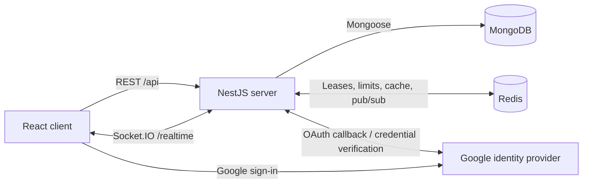

# ChatCord Architecture

Last reviewed: 2026-10-31.

This document describes the implemented system. Planned capabilities and known structural gaps are listed separately. The [README](../README.md) is the progress tracker; this document does not duplicate its task checklist.

## System overview

ChatCord is a single repository containing a React application and a NestJS application. They communicate through a cookie-authenticated REST API and Socket.IO. MongoDB stores persistent application data. Redis stores transient presence/typing state, supports rate limiting and cache utilities, and coordinates Socket.IO broadcasts.



Business rules and authorization live on the server. Both HTTP and socket message creation call the same message service before publishing changes.

## Repository layout

```text
ChatCord/
├── client/                 React/Vite application and its dependencies
│   ├── src/                Application code
│   ├── public/             Public assets
│   └── test/               Opt-in browser fixtures and socket URL checks
├── server/                 NestJS application and its dependencies
│   ├── src/                Production modules and infrastructure
│   └── test/               Controller HTTP specs, Jest setup, and live utilities
├── docs/                   Architecture and feature/verification guides
│   └── decisions/          Reserved for architecture decision records
├── docker/                 Redis development configuration
├── README.md               Status, progress, and development workflow
├── .env.example            Root environment example; app examples/config are separate
├── .gitignore
└── LICENSE
```

The applications have separate package manifests, lockfiles, build commands, and runtime configuration. The Redis Compose service does not yet constitute a containerized full-stack development or production deployment.

## Frontend

The client uses React, TypeScript, Vite, React Router, Tailwind CSS, shadcn/ui components, Axios, TanStack Query, Zustand, and Socket.IO Client.

### Current source structure

```text
client/src/
├── app/                    Router, providers/shell, layouts, sidebar/header, theme
├── features/
│   ├── auth/               Session reads/actions, user search, schemas and contracts
│   ├── friendships/        Relationship queries/actions and social views
│   ├── rooms/              Room/DM APIs, cache keys, forms, membership and invitations
│   ├── messaging/          Message APIs/keys, history/actions, connection orchestration, UI
│   └── realtime/           Socket transport/lifecycle, presence and typing
├── pages/                  Thin route screens and auth forms
├── shared/                 Domain-independent HTTP/errors, UI, hooks, layout preferences
├── styles/index.css        Tailwind and semantic tokens
└── main.tsx                Application bootstrap
```

Internal source imports use the single `@/` alias. Components use PascalCase filenames; hooks use `useX.ts`; other modules use descriptive kebab-case names/suffixes. Generated UI files retain their lowercase convention. Schemas live alongside feature types, rather than inside transport contracts. UI-library generation aliases point at the actual shared paths.

### Data and state boundaries

| Layer | Responsibility |
| --- | --- |
| `shared/api/http-client.ts` | Credentialed HTTP transport |
| Feature `api/` | Typed endpoints, canonical query keys and cache helpers |
| Feature `types/`, `schemas/` | Wire/view contracts and form validation |
| Feature hooks/controllers | Session queries, mutations, paging, invalidation, transient workflow state |
| Route URL | Selected room, DM and deep-linked thread |
| Zustand | Modal/layout/theme preferences and active draft reply; no duplicate session or selected-room store |
| Components | Rendering, local fields and user interaction |
| `useConversationConnection` | Join/leave, reconnect, matching-room cache events and access revocation |

`useSession` and React Query own session reads; `useAuth` adds sign-in/onboarding/logout actions. Logout disconnects transport and clears prior-user caches. The legacy auth store, unused thread/selection state, unreferenced thread/route/header scaffolding and fake header presence have been removed.

Room creation/update hooks do not subscribe to the room list. Room/invitation screens share canonical room-list and membership keys. Message history/search/replies read shared queries; one mounted conversation owns their socket invalidation subscription. Registered-only queries are disabled for guests where those screens mount in the shared shell. Backend authorization remains authoritative.

Feature modules cannot import app/pages; shared modules cannot import features/app/pages. ESLint enforces those layers and selected type-aware promise rules. `check:architecture` also checks aliases, unresolved static imports and cycles. Cross-feature references are explicit, without broad barrel exports.

### Navigation and connection ownership

The three-dot account menu opens a separate Settings layout at `/app/settings`, with Profile and Password detail routes. Profile photos are marked Coming soon; passwords remain managed by Google. Settings preserves a return link to the originating workspace screen.

Routes include sign-in (`/`), OAuth callback, username onboarding, the `/app` workspace, Friends, Invitations, rooms, DMs, and room reply deep links. Client route gates handle session and onboarding UX; backend guards remain authoritative.

`AppLayout` owns the current user's socket connection, including temporary guests. Conversation hooks subscribe to room events without recreating that connection. Guests can discover and join public groups and use their messages/realtime events; social, invitations, room creation and management remain registered-only.

Messages use bounded infinite queries and backend IDs. Events invalidate room/user-scoped history, search, replies, and quote queries. Rejoining refreshes persisted state. A composer clears its draft only after acknowledged delivery; failed sends retain it. Reply deep links use the real replies view. Workspace search filters real room/DM lists and navigates to the result; message-text search remains scoped to the conversation. Route screens load lazily behind Suspense and an error boundary.

## Backend

The server uses NestJS, TypeScript, Mongoose, class-validator/class-transformer, Swagger, Passport/Google authentication libraries, Socket.IO, and Redis.

```text
server/src/
├── common/
│   ├── constants/          Shared authentication/response constants
│   └── pipes/              Identifier validation
├── config/                 Environment validation and configuration mapping
├── database/               Mongoose connection module
├── modules/
│   ├── auth/               Controllers, services, DTOs, guards, decorators,
│   │                       Google strategy, and session schema
│   ├── users/              Profile/search/onboarding service and user schema
│   ├── friendships/        Request/friendship lifecycle and schema
│   ├── rooms/              Groups, DMs, invitations, membership, roles, schema,
│   │                       DTOs, and room event relay
│   ├── messages/           Message/reply/reaction APIs, schema, DTOs, service,
│   │                       and message event relay
│   ├── gateway/            Socket handlers, session guard, error filter,
│   │                       socket authentication, and Redis adapter
│   └── redis/              Redis operations and rate-limit service
├── app.module.ts           Application composition
├── app.controller.ts       Root endpoint
├── app.service.ts
└── main.ts                 HTTP/bootstrap configuration
```

Controller specs live under `server/test/controllers`, with a shared HTTP application helper and Jest configuration under `server/test`. Production modules contain no specs. Request DTOs and schemas live in their owning modules, separately from controller implementations.

### Module responsibilities

| Module | Implemented responsibility |
| --- | --- |
| `AuthModule` | Google sign-in, guest/registered sessions, session inspection/logout, guards, onboarding/search routes delegating to UsersService |
| `UsersModule` | User identity/profile persistence, username search/onboarding, public profile projections |
| `FriendshipsModule` | Pending requests, acceptance/decline/cancel, accepted friendship removal, DM friendship checks |
| `RoomsModule` | Groups and fixed two-person DMs, visibility/capabilities, membership/roles, consent-based invitations, presence peer lookup |
| `MessagesModule` | Persistent messages, author-only edits/deletion, cursor pages, literal search, reply references, and reactions |
| `GatewayModule` | Authenticated socket transport, room subscriptions, sends, presence/typing handlers, and event forwarding |
| `RedisModule` | Transient leases, cache primitives, rate-limit counters, and shared Redis access |
| `DatabaseModule` | MongoDB connection setup |

Controllers validate/delegate HTTP requests. Services enforce business rules and access conditions before accessing models. Gateway handlers apply session validation, event validation, room checks, and relevant rate limits before delegating domain work.

There are no separate `ReactionsModule` or `PresenceModule`: reactions belong to Messages, while presence/typing span Gateway, Redis, and room/friendship access checks. Notifications and uploads modules have not been implemented.

RoomEventsService and MessageEventsService decouple service mutations from gateway publishing. Gateway binds the relays and broadcasts to the appropriate socket rooms through the Redis adapter. These callbacks are not a durable event queue or transactional outbox.

The socket handler class is RealtimeGateway. MessageEventsService is a required injected dependency; its module owns the provider. Message creation and typing share the send-permission rule in RoomsService.

## Persistent and transient data

### MongoDB

MongoDB is the source of truth for persistent state, including server-side sessions.

| Collection | Main data and invariants |
| --- | --- |
| `users` | Registered profiles, Google identity, optional unique username, display name/avatar |
| `sessions` | Token hashes, guest/registered type, optional user reference, idle/absolute expiry, activity metadata |
| `friendships` | Requester/recipient, pending/accepted state, unique canonical pair key |
| `rooms` | Group/DM type, visibility, capabilities, members/roles, embedded invitations, unique sparse DM pair key |
| `messages` | Room/sender, content, reply reference, per-user reactions, timestamps, edit/deletion markers |

Invitations require recipient consent and expire after seven days. DM creation requires an accepted friendship and produces or reuses a canonical two-member room. DM membership is immutable. After unfriending, existing history remains readable by participants while new sends are blocked.

Message deletion replaces content with a placeholder, clears reactions, and records `deletedAt`; the ID remains for existing reply references. Quotes resolve the current parent so deleted or edited text is reflected. Reactions use atomic user/emoji additions/removals. Cursor pages use descending ObjectId order; the client displays ascending order and deduplicates by ID. Search is a bounded, case-insensitive literal content match within one room, not global search or a dedicated search engine.

Room access and mutations use fresh database documents and conditional writes. Cached JSON is not an authorization source. Room changes invalidate ID/slug cache keys.

### Redis

| Use | Current behavior |
| --- | --- |
| Presence | `presence:v2:user:<id>` sorted sets: per-socket 60-second leases, renewed by client snapshots/heartbeats; keys expire after 120 seconds |
| Typing | `typing:v2:<roomId>` sorted sets: five-second leases per user/socket; keys expire after 15 seconds |
| Rate limiting | Expiring counters used by relevant socket handlers |
| Cache | JSON cache helpers; room mutations invalidate keys while authorization bypasses cached data |
| Socket.IO adapter | Pub/sub distributes broadcasts and subscription operations between server instances |

Presence snapshots refresh every 20 seconds. Expired leases are pruned without a global key scan. One tab closing does not mark a user offline while another live lease remains. Online/offline events go to authorized peers' personal socket rooms, not every connected user. Unknown or disconnected client state is displayed as unavailable.

Typing starts are throttled on the client, with stops on idle, blur, empty input, send, room change, and unmount. Receivers hide their own state and expire missed stops. Redis and UI expiry handle lost events; no message draft content is transmitted as typing data.

## Authentication and authorization

Google OAuth redirect and credential verification flows find/create an application user and issue an opaque session token. The browser receives an HTTP-only cookie (`SameSite=Lax`, `Secure` in production); MongoDB stores the token hash. Registered sessions have idle and absolute expiry checked during validation. Guests receive a temporary User document with a generated `guest_<random>` username and a fixed expiry 30 minutes after creation. Their session references that identity and never slides forward with activity. Username onboarding is required for new registered users without a username.

HTTP SessionGuard validates the cookie and attaches the session identity. RolesGuard enforces per-route guest/registered access. Socket namespace middleware validates credentials before connection; SocketSessionGuard revalidates session credentials for subsequent events. User identity comes from the session, never an action payload.

| Action | Backend policy |
| --- | --- |
| Private-group or DM reads | Membership required; public group details can be read by authenticated nonmembers, including guests |
| Message history/details/search | Current room membership required; only messages with createdAt at or after that membership joinedAt are visible in every room type |
| Join/leave | Public groups can be joined; ordinary group members can leave; owners cannot leave without ownership transfer, which is not implemented |
| Group settings/invitations | Owner or moderator; invitees must be registered and accept before joining |
| Role changes/group deletion | Owner only; assigning ownership through role changes is rejected |
| Member removal | Owners can remove nonowners; moderators can remove ordinary members, not peer moderators/owners |
| Message creation/typing start | Membership, text capability, and accepted friendship for DMs; typing also requires subscription |
| Message editing/deletion | Message author and current room member; moderator role does not grant editing/deletion of others' messages |
| Reactions | Current room member; only the caller's reaction is added/removed |
| Presence | Self, accepted friends, and members of shared rooms; unrelated IDs are omitted |

DTO validation rejects unexpected fields and malformed inputs; content length is capped at 4,000 characters. React renders message text rather than inserting user-controlled HTML. These controls do not constitute a completed production security audit: broader HTTP abuse protection, secure-header/CSRF review, deployment configuration, and uploads security remain work to assess or implement.

## REST and Socket.IO contracts

The normal development defaults are client `http://localhost:5173` and server `http://localhost:3000`. The REST prefix is `/api`; Swagger is exposed at `/api/docs`. ConfigModule loads `server/.env.local` before `.env` and validates configuration. Client configuration uses Vite environment variables; see the feature guides for verification-specific ports and origins.

### REST areas

| Area under `/api` | Examples |
| --- | --- |
| Authentication | `GET /auth/google`, `POST /auth/google`, `GET /auth/google/callback`, `POST /auth/guest`, `GET /auth/me`, `POST /auth/onboarding`, `POST /auth/logout` |
| User search | `GET /auth/users/search?q=...` (there is no general UsersController API) |
| Friendships | `GET /friendships`, `GET/POST /friendships/requests`, accept/decline/cancel/remove routes |
| Rooms | Create/list/details/update/delete, join/leave, member profiles/removal/roles, invitation inbox/send/accept/decline |
| DMs | `GET /dms`, `POST /dms` with the other user's ID |
| Messages | `GET/POST /rooms/:roomId/messages`, `GET /rooms/:roomId/messages/page`, message details/edit/delete and reaction routes beneath that room |

The legacy message collection GET remains available; the frontend uses bounded `/page` queries. Room services accept IDs or slugs where supported, while message routes validate MongoDB IDs. Clients use canonical room IDs for subscriptions and message operations.

### Realtime

The Socket.IO namespace is `/realtime`; the transport path remains `/socket.io/`. The client accepts a configured server URL or a full namespace URL and appends the namespace only once.

| Direction | Event | Purpose |
| --- | --- | --- |
| Client → server | `join-room`, `leave-room` | Subscribe/unsubscribe with acknowledgement |
| Client → server | `send-message` | Persist a message through MessagesService, then acknowledge delivery |
| Client → server | `presence-sync` | Renew this socket's lease and fetch authorized presence |
| Client → server | `typing-start`, `typing-stop`, `typing-state` | Transient typing activity and initial snapshot |
| Server → client | `new-message` | Persisted creation from HTTP or socket transport |
| Server → client | `message-updated` | Edited message, deletion placeholder, or reaction change |
| Server → client | `user-online`, `user-offline` | Scoped presence transitions |
| Server → client | `user-typing`, `user-stopped-typing` | Room-scoped typing activity |
| Server → client | `user-joined-room`, `user-left-room` | Socket room subscription changes, not persistent membership changes |
| Server → client | `room-members-changed`, `room-access-revoked` | Refresh room state or remove revoked access |
| Server → client | `connection-error`, `exception` | Connection/setup or unacknowledged handler failures |

Join/leave acknowledge `{ ok: true, roomId }`; message sends acknowledge `{ ok: true, data }`. Handler failures acknowledge `{ ok: false, error }` when a callback exists. Connection rejection also uses Socket.IO's `connect_error`. Presence/typing snapshots have their own documented response fields.

REST remains the primary resource API, but socket message creation is an intentional implemented transport. Both persist through the same service. Successful creation broadcasts to all subscribed tabs, including the sender; client ID deduplication handles broadcast plus acknowledgement. Reconnect rejoins subscriptions and refreshes persisted state; it does not rely on guaranteed replay of every transient event.

## Verification and operational limits

The default backend Jest suite is controller-only. Specs under `server/test/controllers` exercise HTTP routing, DTO validation, session/role restrictions, identity delegation, responses, cookies/redirects, and error propagation. Domain services, session validation, and the external Google boundary are mocked. Coverage collection is limited to controllers. The previous colocated service/gateway/validation specs and generic E2E scaffold were removed by project decision; this suite does not verify service business rules or Socket.IO handlers.

The opt-in `npm run test:integration` suite under `server/test/integration` boots the actual AppModule with MongoDB and Redis. HTTP workflows exercise real services, guards and persistence, including concurrency and authorization. Each run uses a uniquely generated temporary MongoDB database and drops it in teardown. Registered identities are seeded; external Google login is excluded. It runs separately from the controller-only default suite.

See [backend tests](../server/test/README.md) for layout, configuration, cleanup and scope. Prior feature validations included real MongoDB/Redis/Socket.IO and browser checks; they are historical evidence, not part of the default test run. The separate opt-in `verify-*.ts` utilities remain under `server/test`, create isolated fixture records, and clean up their own data. The frontend has a separate Vitest/Testing Library suite (73 behavior tests across fifteen files), strict source/test checks, formatting and layer checks. Browser fixtures remain supplemental, not a comprehensive end-to-end suite. See [frontend verification](../client/test/README.md).

Known limitations and follow-up work:

- The default controller suite runs without MongoDB/Redis/Google or frontend dependencies. The separate API integration suite requires live MongoDB and Redis. The realtime harness still imports Socket.IO Client from `client/node_modules`; automated browser coverage remains unfinished.
- CI execution of the new frontend regression suite, full-stack containers, deployment, structured logging, and monitoring remain unfinished. Redis-only Compose configuration exists; this is not production deployment readiness.
- The Redis adapter supports cross-instance operations, but multi-instance failover/load behavior has not been verified. Polling deployments need an appropriate connection-routing strategy; Redis pub/sub is not durable event delivery.
- Workspace search covers real room/DM names; cross-conversation message-text search is not implemented. Clearly labelled future pinned-space/media features remain outside this cleanup.
- Frontend findings F1–F11 have been addressed; further visual refinement and broader browser/screen-reader coverage remain separate work. See [frontend cleanup](frontend-cleanup-log.md).
- Uploads/attachments, notifications/unread delivery, ownership transfer, and additional identity providers are not implemented end to end.

## Workflow and documentation ownership

Use a dedicated branch for work, validate the affected behavior, review the final changes, commit coherent checkpoints, and merge into stable `main`. Completed branches can be removed after their commits are merged. Branch names are task-specific and follow the project's `feature/...` convention unless otherwise requested.

Update this document when application boundaries, module ownership, storage, authorization, or transport contracts change. Keep implementation-specific details in the linked guides and milestone checklists in the README. Record future significant tradeoffs in `docs/decisions/`.

Related guides:

- [Social API and policies](social-api.md)
- [Friendships API](../server/src/modules/friendships/README.md)
- [Friends frontend](friends-frontend.md)
- [Invitations frontend](invitations-frontend.md)
- [Room permissions](room-permissions.md)
- [Messaging integration](messaging-integration.md)
- [Presence and typing](presence-typing.md)
- [Live realtime verification](realtime-verification.md)

The workspace header links to `/app/notifications`, combining Friends and Invitations sections. Its badge counts incoming friend requests and room invitations. Legacy social routes redirect while preserving invitation parameters. Sidebar room and DM headings have no creation shortcuts; room creation remains in the header and DM creation in Friends.

### Temporary guest lifecycle

`GET /rooms/public?q=` searches public group names literally, returns only id/name/description and caps results at 50. Authenticated guests can list their rooms, join/leave public groups, inspect members after joining, and read/send their messages. Private rooms, DMs, social features, invitations, creation and management are unavailable to guests. Switching a public room to private removes its guest memberships and revokes their socket subscriptions. Guests cannot be promoted to moderators.

GuestLifecycleService removes expired memberships, sessions and User documents in retryable batches every 30 seconds and on startup. HTTP validation and per-connection socket expiry enforce the absolute deadline independently of cleanup. Message history remains; deleted identities use the existing missing-user fallback. The frontend displays the generated username, time remaining and Google sign-in link, hides account settings/creation/social controls, clears cached data at expiry and returns to sign-in. Google sign-in creates/uses a registered account; guest memberships are not migrated.

### Join-time message history

RoomsService.messageAccess supplies the authoritative current membership timestamp. Message listing, paging, search, direct reads, reactions, edits, deletion and reply-target resolution all enforce that cutoff; unknown message IDs and pre-join messages both return not found. Leaving/rejoining gets a fresh joinedAt. MessageEventsService publishes through the gateway, which intersects subscribed sockets with current eligible memberships before sending new-message or message-updated payloads, so edits/reactions to old messages do not reveal them to newcomers. Failed fanout never falls back to an unfiltered broadcast.

Client history/detail keys include membership joinedAt. Joining/leaving clears prior membership caches; disabled histories render no cached messages. Public rooms hide the Who can join selector; private rooms retain it. The member dialog and join prompt explain the history rule.

### Trusted room activity

Message documents distinguish legacy/user messages from kind=system activity notices with a systemEvent discriminator. RoomActivityService snapshots usernames into human-readable notice text after successful room mutations. It covers direct/invited joins, leaves, kicks, expiry, renames, capability/visibility/description changes and roles; unchanged saves and failed actions create no notice. Guest cleanup records expiry departures before deleting the guest identity.

MessageEventsModule owns the message model/events provider and is shared by MessagesModule and RoomActivityModule. The activity module depends on public user profiles and message persistence/events, without importing RoomsModule or AuthModule; this avoids a circular module dependency. Notices use the existing join-time query filters and eligible socket audience. User DTOs reject system metadata; reply/reaction/edit/delete APIs disallow system messages. Persistence/live-delivery failures are logged without reversing an already completed room change; these notices are informational rather than a transactional audit ledger.
